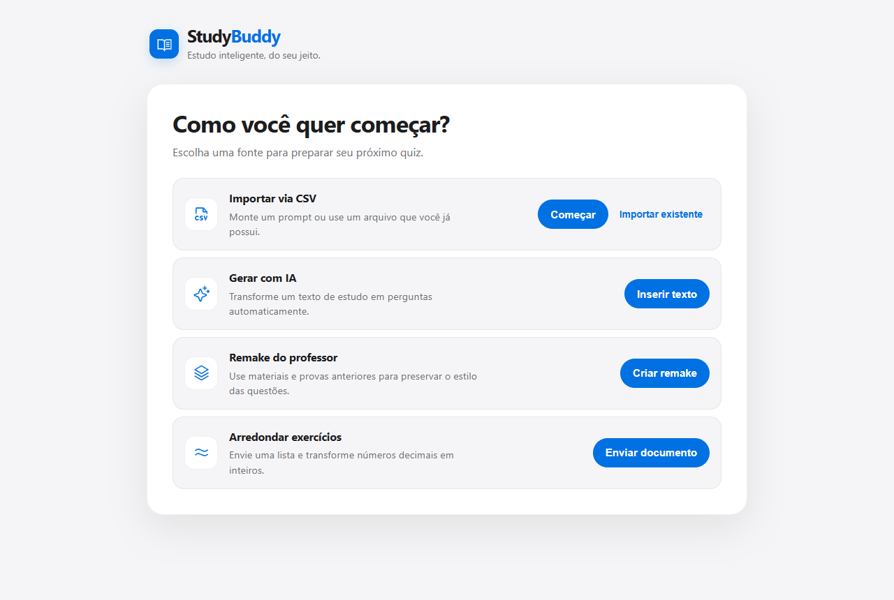
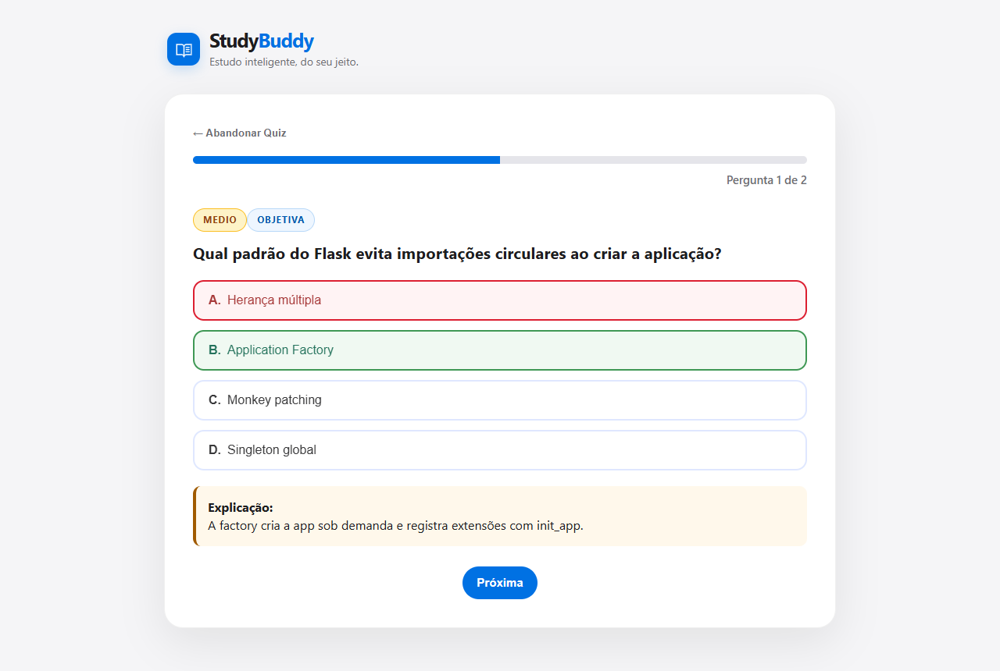

# StudyBuddy


Gerador de quizzes de estudo que roda direto no navegador. Transforma textos, PDFs e provas antigas em perguntas objetivas, discursivas ou de verdadeiro ou falso, com correção, explicações e suporte a fórmulas matemáticas.



## Como funciona

| Modo | O que faz |
| --- | --- |
| **Importar via CSV** | Monta um prompt estruturado para qualquer IA externa e importa o CSV gerado, por arquivo ou colando o texto |
| **Gerar com IA** | Gera as perguntas direto no site a partir de um texto de estudo, usando o roteador de inferência do Hugging Face |
| **Remake do professor** | Analisa provas anteriores e o material da disciplina para criar questões novas no mesmo estilo do professor |
| **Arredondar exercícios** | Recebe uma lista de exercícios e reescreve os números decimais como inteiros |

## Destaques

- **Quatro tipos de pergunta**: objetivas, discursivas, verdadeiro ou falso e mistas.
- **Prompts com regras anti-viés**: evitam alternativas que entregam a resposta por eliminação e mantêm a consistência técnica do domínio.
- **Correção de discursivas com IA**, a partir de critérios de avaliação gerados junto com a pergunta.
- **Leitura de documentos** PDF (pdf.js) e DOCX (mammoth) no próprio navegador.
- **Fórmulas em LaTeX** renderizadas com MathJax.
- **Rodadas que aprendem com você**: o próximo prompt evita repetir perguntas e leva os seus erros anteriores para reforçar esses temas.
- **Configurações do quiz**: gabarito imediato, embaralhamento, navegação e uma ou todas as perguntas por tela.



## Executar

Não precisa de build nem de dependências. Sirva a pasta com qualquer servidor estático:

```bash
python -m http.server 8000
```

Abra http://localhost:8000.

Os modos **Importar via CSV** e **Remake** (com a opção de copiar o prompt) funcionam sem conta em nenhum serviço. Para gerar perguntas ou corrigir discursivas direto no site, crie um token gratuito em [huggingface.co/settings/tokens](https://huggingface.co/settings/tokens). O app pede o token na primeira geração e o guarda **apenas no seu navegador** (`localStorage`); se ele for recusado, é descartado e pedido de novo.

## Formato do CSV

```csv
pergunta,opcao_a,opcao_b,opcao_c,opcao_d,resposta_correta,explicacao,tema,nivel,tipo
```

Há um exemplo em [`perguntas.csv`](perguntas.csv).

## Stack

HTML, CSS e JavaScript puros · Hugging Face Inference Router (Gemma) · pdf.js · mammoth · MathJax
